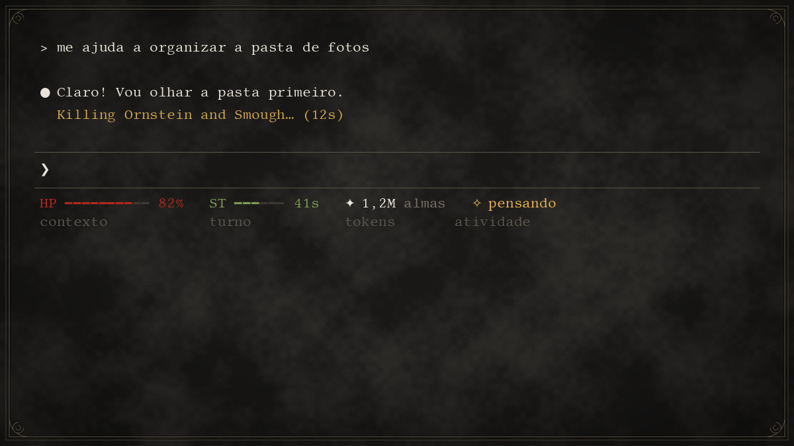
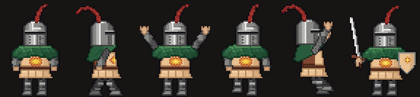
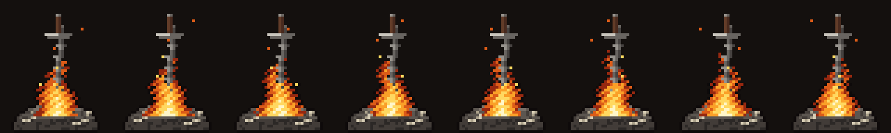
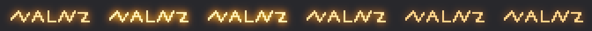

# thema ds1 claude

Tema **Dark Souls 1** para o [Claude Code](https://claude.com/claude-code) no **Windows 10/11 + WSL (Ubuntu)**.
O Solaire de Astora vive na sua barra de tarefas, o terminal vira o menu da fogueira e a linha de status vira o HUD do jogo.



## O que vem

| | |
|---|---|
| **Terminal "Claude DS1"** | Perfil do Windows Terminal no estilo do menu da fogueira: pedra escura, moldura com volutas nos cantos, fonte serifada (Libertinus Mono), texto creme e seleção marrom-alaranjada. |
| **HUD na linha de status** | `HP` (vermelha) = contexto que resta, `ST` (verde) = duração do turno, `✦ almas` = tokens gastos na conversa, e o que o Claude está fazendo. Com pouco HP aparece `ESTUS? /compact`. |
| **Frases de chefe** | Enquanto pensa, o Claude mostra "Killing Ornstein and Smough", "Praise the Sun", "Try Finger But Hole"... |
| **Barra do tmux** | Preta com dourado. `HUMANIDADE` = quantos Claudes estão abertos, `PESO` = memória do WSL em uso (verde, laranja ou vermelho). |
| **Solaire na tela** | Anda em cima da barra de tarefas, escala as janelas, fala frases do jogo e faz *Praise the Sun* quando o Claude termina um turno longo. |
| **Menu do Solaire** | Clique direito nele: fogueira, painel do Claude, Claude novo, escrever mensagem, louvar o sol, dispensar. Os atalhos do **seu dash** entram no topo (ver [Ligar o seu dash](#ligar-o-seu-dash)). |
| **Arrastar arquivo no Solaire** | Ele pergunta se é pra resumir ou só olhar e abre um Claude novo (janela nova do tmux) com o arquivo. |
| **Você foi invadido** | `solaire_aviso "Título" "detalhe" invasao "https://link"` abre a faixa vermelha e o Solaire fica em guarda com espada e escudo até você abrir o caso. Bom pra ligar em qualquer script que precise te chamar com urgência. |
| **Mensagens de orange soapstone** | `lembrete 15h "Ligar pro fulano"`: na hora aparece a marca laranja brilhando no chão, o Solaire vai até ela e abre a mensagem (Feito / +10 min / +1 h). |
| **Fogueira do dia** | Ao ligar o PC: tela escurece, "BONFIRE LIT", e um quadro com as mensagens do dia, o resumo do seu dash (se ligar um) e o limite do Claude. |
| **Painel das sessões** | Janela sempre por cima com cada Claude aberto, o que está fazendo e as tarefas em segundo plano (estilo menu do DS). |
| **Barra de vida de chefe** | `barra "Título" arquivo`: tarefas longas viram barra de vida de chefe; no fim, "INIMIGO ABATIDO" ou "VOCÊ MORREU". |
| **Widget de limites** | Barrinhas finas do limite de 5 h e da semana em cima da barra de tarefas. 90%: "ESTUS: 1", 95%: "DON'T GO HOLLOW", 99%: "YOU DIED". |
| **Cursor dourado** | Seta, mãozinha e texto dourados (grandes, 144 px) e o sol do Solaire girando no lugar da ampulheta. Opcional. |



> Como o Solaire e os outros desenhos foram feitos (referência, scripts, cada versão e como regerar): **[docs/BONECOS.md](docs/BONECOS.md)**




## Instalar

Precisa de: Windows 10/11, WSL com Ubuntu, Windows Terminal, Claude Code instalado no WSL, `python3` e `tmux`
(`sudo apt install python3 tmux`).

No terminal do Ubuntu:

```bash
git clone https://github.com/WHdragon770/thema-ds1-claude.git
cd thema-ds1-claude
bash instalar.sh
```

Depois abra o atalho **Claude DS1** na Área de Trabalho. Dentro dele, rode `tmux` e depois `claude`
(ou ponha no fim do `~/.bashrc` para abrir direto: `[[ $- == *i* && -z "$TMUX" ]] && exec tmux new -A -s main "claude; exec bash"`).

O instalador faz backup de tudo que muda (`~/.claude/settings.json`, `~/.tmux.conf` e o `settings.json` do Windows Terminal ficam com cópia `.antes-ds1`).

**Desinstalar:** `bash desinstalar.sh` (volta os backups, o cursor e tira os atalhos).

## Ligar o seu dash

Se você tem um painel/dashboard seu (uma página HTML, um site interno, uma planilha, um script que junta pedidos, tarefas, chamados...),
o tema conversa com ele em 4 lugares. Nada disso vem ligado: o tema não traz dashboard nenhum, você aponta para o seu.

Tudo fica num arquivo só: **`%LOCALAPPDATA%\ThemaDS1\meu_dash.json`**. Copie o `meu_dash.exemplo.json` da mesma pasta,
renomeie e troque os caminhos. Pode usar só a parte que quiser; sem o arquivo, tudo funciona como antes.
O `desinstalar.sh` guarda ele em `~/meu_dash.json` e o `instalar.sh` religa sozinho.

```json
{
  "menu": [
    { "titulo": "Meu dashboard",     "abrir":  "C:\\Users\\VOCE\\Documents\\Meu Dash\\dashboard.html" },
    { "titulo": "Atualizar o dash",  "rodar":  "C:\\Users\\VOCE\\Documents\\Meu Dash\\atualizar.bat" },
    { "titulo": "Rodar o meu check", "claude": "/meu-check" }
  ],
  "fogueira": {
    "resumo": "C:\\Users\\VOCE\\Documents\\Meu Dash\\hoje.json",
    "gerar":  "C:\\Users\\VOCE\\Documents\\Meu Dash\\gerar_hoje.bat",
    "abrir":  "C:\\Users\\VOCE\\Documents\\Meu Dash\\dashboard.html"
  },
  "painel": [
    { "titulo": "Meu dash (atualização)", "progresso": "C:\\Users\\VOCE\\Documents\\Meu Dash\\progresso.txt" }
  ]
}
```

No JSON a barra invertida é dobrada (`\\`). Caminhos do Windows; no `progresso` também vale caminho do WSL (`/home/...`).

### 1. Menu do Solaire (`menu`)

Cada item vira uma linha no topo do clique direito, com um separador antes dos itens do tema. Escolha uma ação por item:

| campo | o que faz |
|---|---|
| `abrir` | Abre um link (`https://...`) ou arquivo (`C:\...\dashboard.html`) no programa padrão. |
| `rodar` | Roda um `.bat`/`.exe` escondido. Bom pra "atualizar o dash agora". |
| `claude` | Abre um Claude novo (janela nova do tmux) já com esse texto: um comando seu (`/meu-check`) ou um pedido ("vê o que venceu hoje no dash"). |

O menu é lido quando o Solaire abre; mudou o arquivo, dispense e abra ele de novo (ou reinicie o PC).

### 2. Fogueira do dia (`fogueira`)

Depois do "BONFIRE LIT", o quadro mostra as mensagens do dia, **as seções do seu dash** e o limite do Claude.

- `resumo` (obrigatório pra aparecer): um JSON que **o seu dash grava** com o que importa hoje.
- `gerar` (opcional): `.bat`, `.exe` ou `.ps1` que a fogueira roda antes de ler o resumo, pra ele estar fresco (espera até 20 s).
- `abrir` (opcional): link ou arquivo; aparece o botão **Abrir o dash** no quadro.

Formato do `resumo` (exemplo completo em `exemplo_dash\hoje.json`):

```json
{
  "secoes": [
    { "titulo": "PRA HOJE", "vazio": "Nada vencendo hoje.",
      "itens": [ { "tag": "PRAZO", "cor": "#B0281C", "titulo": "Responder o pedido 123", "detalhe": "vence às 18h" } ] },
    { "titulo": "PEDIDOS", "resumo": "3 aguardando · 1 em disputa · 2 novos desde ontem" }
  ]
}
```

Cada seção vira um título dourado. `itens` vira uma lista com a etiqueta colorida (`tag` + `cor` em `#RRGGBB`) e o `detalhe` embaixo
(até 8 por seção, o resto vira "+ N no dash"). `resumo` é uma linha em destaque (bom pra contagens). `vazio` é o texto quando não tem nada.
Se o arquivo não abrir, aparece "Não consegui ler o resumo do seu dash" e o resto da fogueira segue normal.

### 3. Painel das sessões (`painel`)

Se o seu dash se atualiza sozinho (tarefa agendada, script longo), ele aparece no painel em **Tarefas em segundo plano** com barra de vida de chefe.
O script do dash só precisa escrever no arquivo `progresso`, uma linha por passo:

```
3 10 lendo pedidos
7 10 montando o resumo
FIM dash atualizado          (ou: ERRO não achei a planilha)
```

`atual total texto` atualiza a barra; `FIM`/`ERRO` fecha e o Solaire avisa. Some do painel 10 min depois do fim.

### 4. Invasão e avisos (sem configurar nada)

Quando o seu dash achar algo urgente (reclamação nova, servidor caiu, prazo estourando), ele chama o Solaire:

- do **WSL**: `solaire_aviso "Reclamação nova" "pedido 123" invasao "https://seu-dash/pedido/123"`
- do **Windows** (qualquer linguagem): grave um arquivo `.json` em `%LOCALAPPDATA%\PetSolaire\avisos\`
  (grave com outro nome e renomeie pra `.json` no fim, pra ele não ler pela metade):

```json
{ "titulo": "Reclamação nova", "texto": "pedido 123", "tipo": "invasao", "link": "https://seu-dash/pedido/123" }
```

`tipo`: `ok` (sol + Praise the Sun), `erro` ou `invasao` (faixa vermelha "VOCÊ FOI INVADIDO", ele fica em guarda até você abrir o caso pelo link).

## Onde fica cada coisa

- `~/bin/` no WSL: `solaire_aviso`, `lembrete`, `solaire_claude`, `barra`, `painel`, `limites`, `fogueira`, `tmux_hud`, `claude_status.py` (hooks) e `claude_painel.py` (coletor do painel).
- `~/.claude/statusline-ds1.py`: o HUD.
- `%LOCALAPPDATA%\PetSolaire`: o Solaire (`pet.ps1` tem a configuração no topo: velocidade, falas, chance de louvar, `$SUMIR`...).
- `%LOCALAPPDATA%\ThemaDS1`: painel, widget de limites, barra de chefe, fogueira, cursor, fundo do terminal, fontes e o `meu_dash.json` (se você criar).
- `geradores/`: scripts Python (numpy + Pillow) que desenham os sprites, a fogueira, o soapstone, o cursor e o fundo de pedra, se quiser mexer no visual.

## Comandos

```bash
solaire_aviso "Backup terminou" "42 arquivos"            # sol + Praise the Sun
solaire_aviso "Deu ruim" "disco cheio" erro
solaire_aviso "Cliente reclamou" "pedido 123" invasao "https://exemplo.com/pedido/123"
lembrete 15h "Ligar pro fornecedor"                      # 15:30 | amanhã 9h | 24/10 10h | +30m
lembrete lista
fogueira -r                                              # abre o resumo do dia sem a animação
barra "Render" /tmp/progresso.txt                        # o processo escreve "atual total texto" e no fim "FIM ok"
```

## Créditos

Feito por fã. Dark Souls, Solaire de Astora e tudo relacionado são da FromSoftware / Bandai Namco; este projeto não tem ligação com elas.
Os sprites, a fogueira e o fundo são pixel art/desenho originais gerados pelos scripts em `geradores/`.
Os cursores seguem o formato dos cursores de Acessibilidade do Windows.
Fontes: [Cinzel](https://fonts.google.com/specimen/Cinzel) e [Libertinus Mono](https://fonts.google.com/specimen/Libertinus+Mono), licença SIL OFL (ver `windows/fontes/`).
Código: licença MIT.
