# Como os bonecos foram feitos

Tudo que é desenho no tema (o Solaire, o sol, a fogueira, a marca de soapstone, os cursores e o fundo do terminal) foi
**gerado por código**, em Python com `numpy` + `Pillow`. Nenhum pixel foi pintado à mão num editor: cada peça é uma forma
geométrica (polígono, elipse, cápsula) pintada com uma paleta fixa, e cada quadro de animação é a mesma função chamada
com parâmetros diferentes. Assim dá pra mexer num detalhe (a cor da capa, o tamanho do elmo) e regerar a folha inteira.

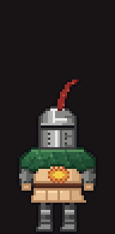 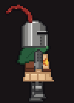 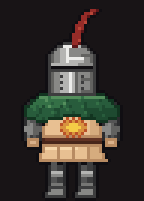 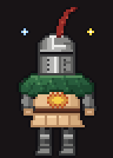 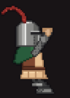 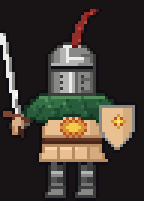

## Sumário

- [Referência](#referência)
- [A evolução do Solaire (4 versões)](#a-evolução-do-solaire-4-versões)
- [Como o gerador final funciona](#como-o-gerador-final-funciona)
- [A spritesheet e o pet.ps1](#a-spritesheet-e-o-petps1)
- [Os outros desenhos](#os-outros-desenhos)
- [Regerar tudo](#regerar-tudo)
- [Mapa dos arquivos](#mapa-dos-arquivos)

## Referência

O ponto de partida foram duas folhas de sprites do Solaire de Astora em pixel art, com andar de frente, lado e costas,
*Praise the Sun* e uma versão "tonta":

| folha 1 (andar + Praise the Sun) | folha 2 (andar + tonto) |
|---|---|
| 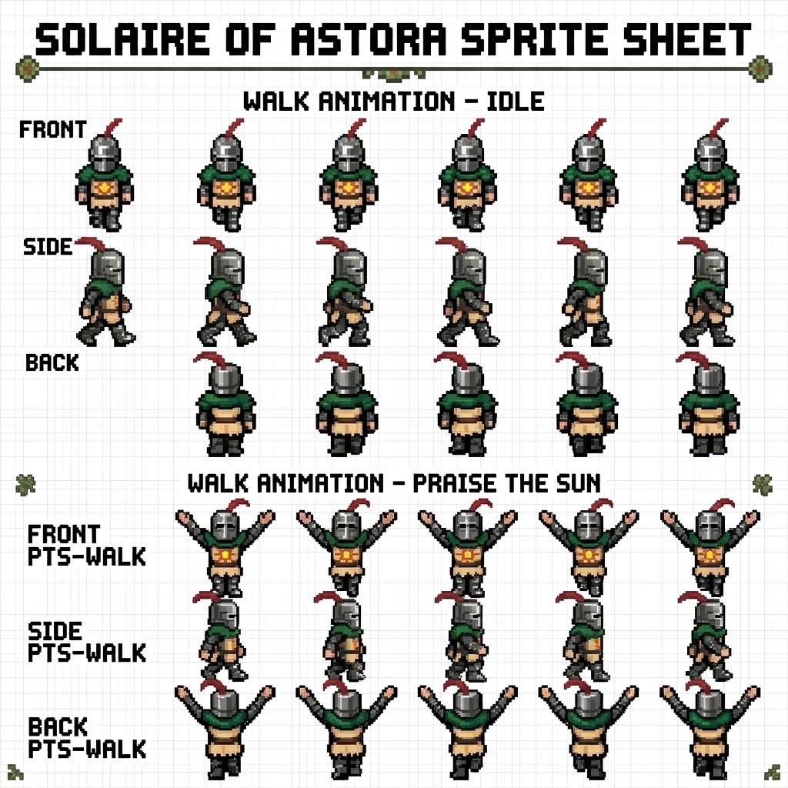 | 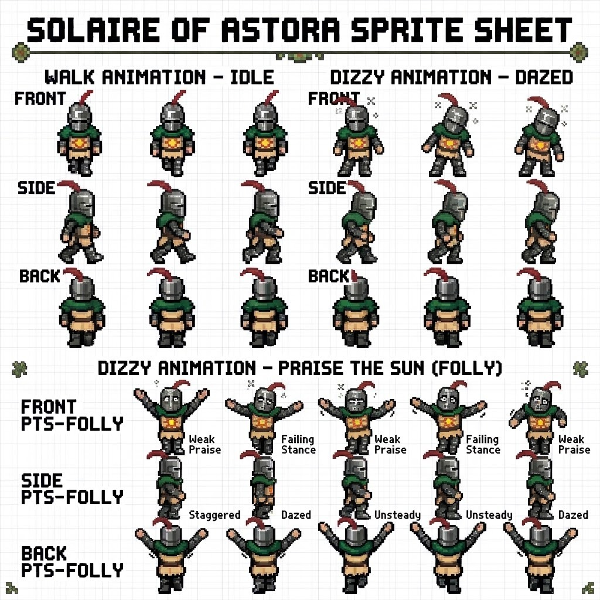 |

Arquivos: [`bonecos/referencias/folha1.jpg`](bonecos/referencias/folha1.jpg) e [`folha2.jpg`](bonecos/referencias/folha2.jpg).
Elas são JPEG com grade quadriculada no fundo, então não dá pra usar direto como sprite (tem borrão de compressão,
fundo que não é transparente e os quadros não têm o mesmo tamanho). Delas saíram:

- **as cores**: aço do elmo, verde da capinha, vermelho da pluma, bege do tabardo, laranja/amarelo do sol, marrom do cinto;
- **as proporções**: elmo grande e arredondado (cabeça ~1/3 do corpo, estilo chibi), capa larga nos ombros, pernas curtas;
- **os detalhes que fazem ser o Solaire**: fenda escura do elmo com brilho em "Γ", pluma fina na diagonal, sol em blocos no peito.

## A evolução do Solaire (4 versões)

### v1: desenho simples, 28x32 ([`geradores/historico/gerar_sprites.py`](../geradores/historico/gerar_sprites.py))

Python puro (só `zlib`, sem Pillow), cada quadro desenhado com retângulos e uma paleta de letras (`'h'` = aço, `'g'` = verde...).
Funcionou, mas ficou "boneco de palito": pouco pixel pra caber o elmo, a capa e o sol.

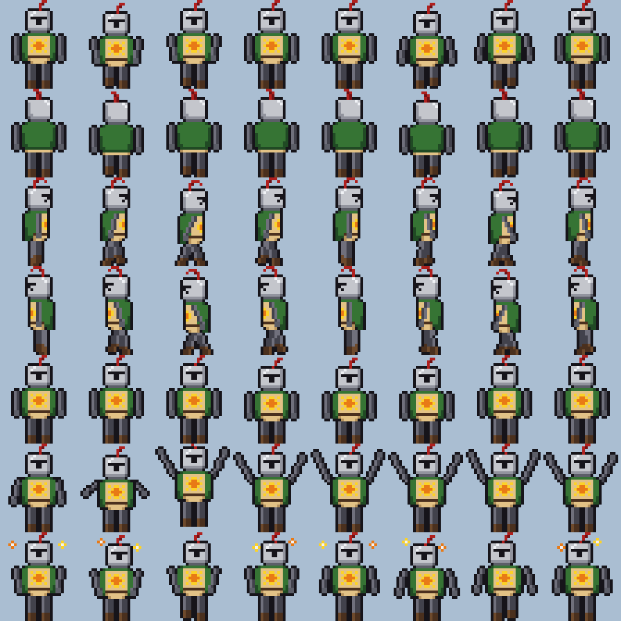

### v2: recortar da referência ([`historico/recortar.py`](../geradores/historico/recortar.py) e [`historico/montar.py`](../geradores/historico/montar.py))

A ideia era usar os quadros da própria folha. O `recortar.py` acha cada boneco pela faixa de linha da folha, separa do
fundo (a grade é clara e pouco saturada, o boneco é escuro ou colorido) com `scipy.ndimage` (rótulo de componentes +
fechar buracos), corta e reduz pra 70%. O `montar.py` foi além: tem a caixa (x0, x1) de cada quadro nas duas folhas, alinha
todos pelo capacete (senão o boneco treme ao andar), escolhe a ordem dos passos que dá o ciclo mais suave (testa as
permutações com `itertools`) e inventa animações que a folha não tem (parado respirando, pluma balançando, agachar + pulo
no Praise, tonto ao soltar).

Ficou fiel, mas o JPEG deixou borda suja e cores borradas, e os quadros não têm o mesmo traço entre si.

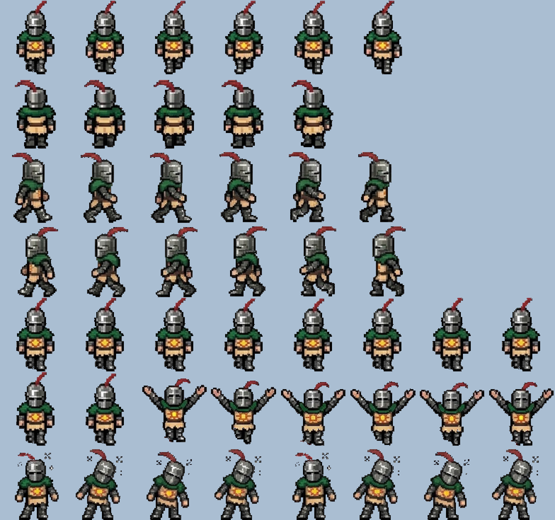

### v3: pixel art "HD" desenhada por formas, 48x64 ([`geradores/gerar_hd.py`](../geradores/gerar_hd.py))

Mais pixels e mais detalhe, agora com o motor que ficou: a classe `Tela` (ver abaixo), materiais com 5 tons cada,
sombreamento por luz vindo da esquerda, textura de malha nos braços e contorno escuro em volta. Ficou bonito, mas com
cara de "outro Solaire": elmo alto e quadrado, capa comprida, sol grande demais.

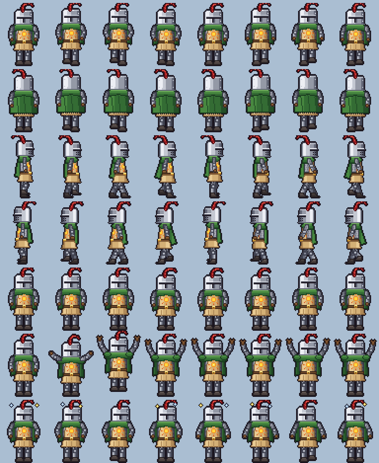

### v4 (final): HD refeito em cima da referência ([`geradores/gerar_ref.py`](../geradores/gerar_ref.py))

Usa o motor do `gerar_hd.py` (importa `Tela` e `sol`), mas redesenha cada peça medindo a folha 1: largura do elmo linha a
linha, onde começa a capa, altura do tabardo, cores pegas com conta-gotas da referência. Pra conferir, o
[`ferramentas/comparar.py`](../geradores/ferramentas/comparar.py) põe o meu quadro em cima e o da referência embaixo, na
mesma altura:

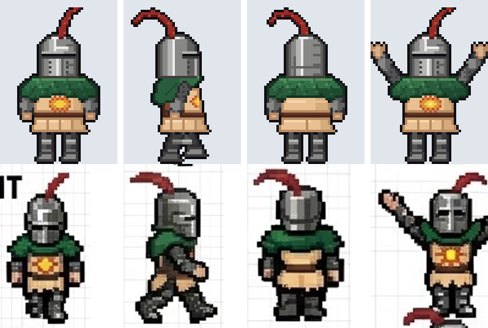

Depois ganhou linhas novas que a referência não tinha: **escalar** (subir nas janelas, de lado com braços alternando)
e **combate** (espada e escudo do sol, pra quando "você foi invadido").

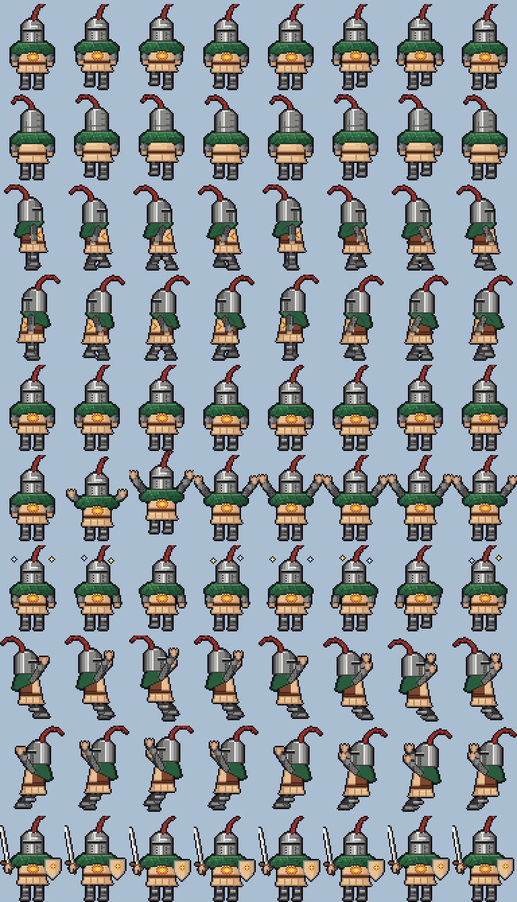

## Como o gerador final funciona

### 1. Máscaras (formas)

Tudo é desenhado numa célula de 48x64 px. A classe `Tela` (em `gerar_hd.py`) cria **máscaras booleanas** do tamanho da célula:

| função | forma | usada em |
|---|---|---|
| `Tela.poli(pontos)` | polígono preenchido (varredura linha a linha) | capa, tabardo, saia, botas |
| `Tela.elipse(cx, cy, rx, ry)` | elipse | mãos, joelhos |
| `Tela.capsula(p0, p1, r)` | segmento com ponta redonda | braços, pernas, pluma, lâmina da espada |
| `Tela.ret(x0, y0, x1, y1)` | retângulo | detalhes |

O elmo é diferente: tem uma tabela `HW` com a meia-largura de cada linha (`[3, 5, 6, 7, 8, 8, ...]`), o que dá o domo
redondo em cima igual ao da referência.

### 2. Pintura com volume

Cada material tem 5 tons, do mais claro ao mais escuro:

```python
ACO   = [(236,236,234), (180,180,178), (136,136,134), (98,98,96), (62,62,62)]
VERDE = [(84,142,92), (52,112,70), (40,92,60), (30,74,48), (18,52,32)]
PLUMA = [(184,70,56), (150,44,40), (122,32,32), (90,22,24)]
TAN   = [(246,214,170), (232,192,146), (214,172,126), (184,140,98), (150,106,70)]
```

O tom de cada pixel sai da posição dele dentro da peça. No modo `'cil'` (cilindro com luz da esquerda) a peça fica
escura na beirada esquerda, clara logo depois, média no meio e escura à direita, que é o truque clássico de pixel art pra
dar volume. Tem também `'pano'` (menos contraste, pra tecido) e `'cima'` (claro em cima, pro topo do elmo). A malha dos
braços escurece um tom num padrão xadrez de 2 em 2. A borda de cada peça leva o tom mais escuro, o que separa as peças
por dentro (capa da armadura, braço do tronco).

### 3. Ordem das camadas e contorno

Cada pose pinta de trás pra frente: pluma, braço de trás, perna de trás, saia, tronco, capa, elmo, braço da frente.
No fim, `contorno()` acha todo pixel transparente que encosta num pixel pintado e pinta ele de quase preto
(`(16, 14, 18)`). É o contorno de 1 px que deixa o boneco legível em cima de qualquer janela.

### 4. Poses e animação

As poses são funções com parâmetros, e cada quadro é uma chamada:

- **`frente(bob, pes, bal, maos, cab_dx, pluma_dx, brilho, costas, estrelas)`**: `bob` sobe/desce o corpo, `pes` levanta
  cada pé, `bal` balança os braços, `maos` = `'baixo' | 'meio' | ('cima', abre) | 'combate'`, `brilho` acende o sol do peito.
- **`lado(f)`**: andar de perfil, `f` de 0 a 1 é a fase do passo. O passo é `6·sen(2πf)`, o pé de trás levanta quando
  `cos > 0.3`, os braços balançam ao contrário das pernas e a capa ondula com `sen(4πf)`. A esquerda é a direita espelhada.
- **`escalar(q)`**: de lado, braços alternando pra cima e corpo subindo com `sen`.

As linhas da folha são listas dessas chamadas, por exemplo o Praise the Sun:

```python
def linha_louvor():
    out = [frente(), frente(2, maos='meio', pluma_dx=-1), frente(0, (2, 2), maos=('cima', 1), brilho=1, pluma_dx=-1)]
    for q in range(5):
        out.append(frente(maos=('cima', q % 2), brilho=q % 2, pluma_dx=[0, 1, 0, -1, 0][q]))
    return out
```

Ou seja: em pé, agacha com os braços no meio, pula com os braços pra cima (esse quadro sobe 3 px na célula) e fica em
V com o sol do peito piscando e a pluma balançando. O **tonto** gira duas estrelinhas (amarela e azul) em volta do
elmo com `cos/sen` e balança a cabeça; o **combate** usa `maos='combate'` + `espada_escudo()`, com um brilho que corre
pela lâmina.

### 5. O sol

O sol que nasce em cima dele no Praise (`sol()` em `gerar_hd.py`) é calculado por pixel: miolo em 3 tons pela distância
do centro, anel escuro, 8 raios com `cos(8·ângulo)` e raios menores entre eles, carinha sorrindo. 4 quadros girando
`π/16` cada.

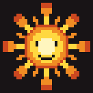

## A spritesheet e o pet.ps1

O gerador grava **uma imagem só**, [`windows/PetSolaire/spritesheet.png`](../windows/PetSolaire/spritesheet.png): 8 colunas
x 10 linhas, célula 48x67 (64 + 3 px de folga em cima pro pulo não cortar a pluma).

| linha | nome | o que é |
|---|---|---|
| 0 | `frente` | andando pra baixo/de frente |
| 1 | `costas` | andando de costas |
| 2 | `direita` | andando pra direita (perfil) |
| 3 | `esquerda` | a direita espelhada |
| 4 | `parado` | respirando, pluma balançando |
| 5 | `louvor` | Praise the Sun |
| 6 | `tonto` | depois de cair de uma janela ou ser solto |
| 7 | `escalar` | subindo janela pela direita |
| 8 | `escalar_e` | o mesmo espelhado |
| 9 | `combate` | espada e escudo, em guarda |

O `pet.ps1` (PowerShell + WPF) lê essa folha e corta pela grade, com a ordem em `$LINHAS` e quantos quadros usar de
cada linha em `$QUADROS`. A animação roda a `$ANIM_FPS = 8`, a janela a 30 FPS. Quer trocar o boneco por outro? Basta
gerar uma folha no mesmo formato.

## Os outros desenhos

Mesma técnica (máscara + paleta + contorno), cada um no seu gerador:

| | gerador | saída |
|---|---|---|
| 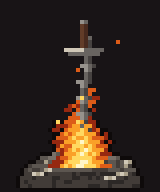 | [`gerar_fogueira.py`](../geradores/gerar_fogueira.py): monte de cinzas e ossos, espada espiralada cravada, fogo em 5 tons tremulando (8 quadros 40x48) | `windows/Fogueira/bonfire.png` |
| 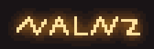 | [`gerar_soapstone.py`](../geradores/gerar_soapstone.py): rabisco achatado (como escrito no chão), traços ligados ponto a ponto, brilho com desfoque gaussiano pulsando (6 quadros 56x18) | `windows/PetSolaire/soapstone.png` |
|  | [`gerar_cursor.py`](../geradores/gerar_cursor.py) grava `.cur` e `.ani` na mão (BMP 32 bits + máscara). [`gerar_cursor2.py`](../geradores/gerar_cursor2.py) pega o formato dos cursores grandes de Acessibilidade do Windows (`*_eoa.cur`) e troca o preenchimento por dourado do sol; a ampulheta vira o sol girando | `windows/CursorDS1/` |
|  | [`gerar_fundo.py`](../geradores/gerar_fundo.py): pedra escura com ruído em várias escalas, vinheta e moldura dupla com volutas nos cantos (estilo menu da fogueira) | `windows/TerminalDS1/fundo_ds1.png` |

## Regerar tudo

Precisa de `python3` com `numpy` e `Pillow` (`pip install --user numpy pillow`; o `historico/` também usa `scipy`).
Na raiz do repo:

```bash
python3 geradores/gerar_ref.py windows/PetSolaire          # spritesheet.png + sol.png (+ previa_folha.png, pode apagar)
python3 geradores/gerar_soapstone.py windows/PetSolaire
python3 geradores/gerar_fogueira.py windows/Fogueira
python3 geradores/gerar_fundo.py windows/TerminalDS1/fundo_ds1.png
python3 geradores/gerar_cursor2.py windows/CursorDS1 "/mnt/c/Users/VOCE/AppData/Local/Microsoft/Windows/Cursors"

# imagens desta página
python3 geradores/ferramentas/previas_docs.py
python3 geradores/ferramentas/comparar.py windows/PetSolaire/spritesheet.png docs/bonecos/referencias/folha1.jpg docs/bonecos/comparacao.png
```

Os geradores são determinísticos: rodando de novo sai a mesma imagem, byte a byte.

As versões antigas também rodam, se quiser ver:

```bash
mkdir -p /tmp/v1 /tmp/v2 /tmp/v2b
python3 geradores/historico/gerar_sprites.py /tmp/v1
python3 geradores/historico/recortar.py docs/bonecos/referencias/folha1.jpg /tmp/v2
python3 geradores/historico/montar.py docs/bonecos/referencias /tmp/v2b
```

Pra olhar quadros de perto: `python3 geradores/ferramentas/zoom.py spritesheet.png zoom.png 0,0 5,3` (linha,coluna; amplia 5x).

## Mapa dos arquivos

```
geradores/
  gerar_hd.py          motor (Tela, materiais, contorno) + sol + Solaire v3
  gerar_ref.py         Solaire final (usa o motor do gerar_hd.py)
  gerar_soapstone.py   marca de orange soapstone
  gerar_fogueira.py    fogueira
  gerar_cursor.py      cursores pixel art + escrita de .cur/.ani
  gerar_cursor2.py     cursores dourados no formato dos de Acessibilidade
  gerar_fundo.py       fundo do terminal
  ferramentas/         comparar.py, zoom.py, previas_docs.py
  historico/           gerar_sprites.py (v1), recortar.py e montar.py (v2)
docs/bonecos/
  referencias/         folha1.jpg, folha2.jpg
  evolucao/            prévia de cada versão
  anim/                GIFs desta página
  comparacao.png       final x referência
```
